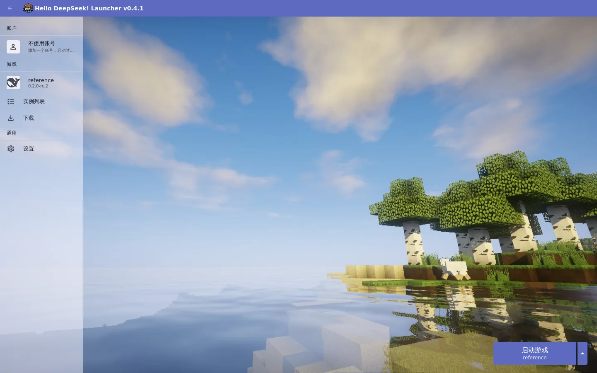
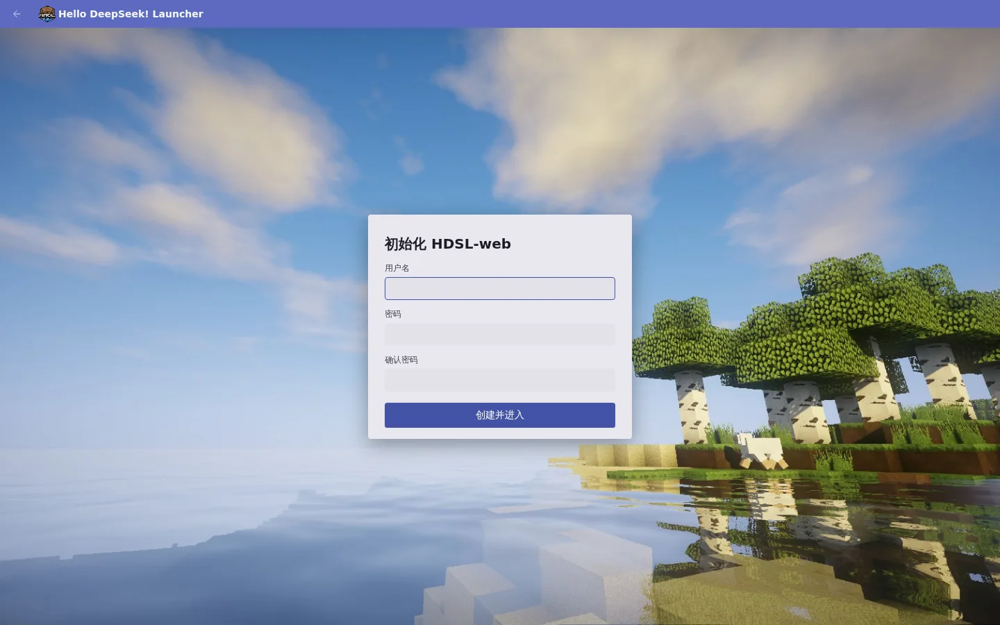
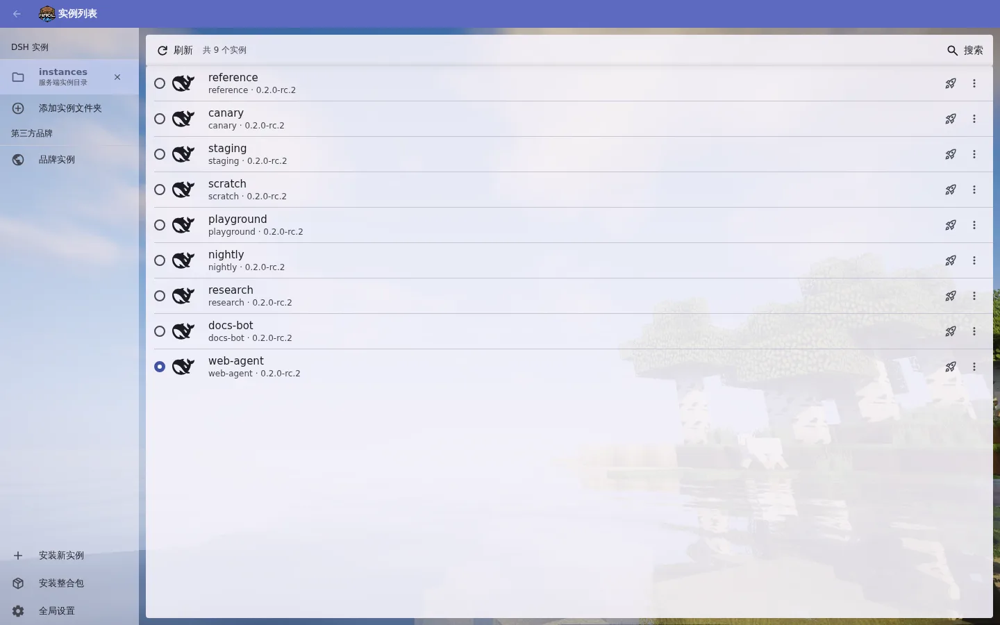
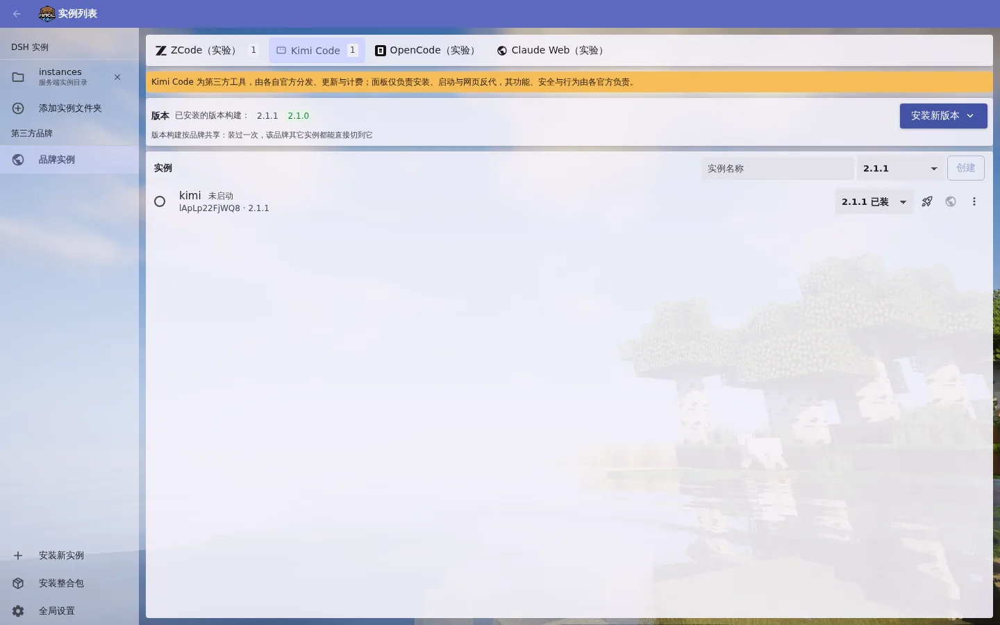
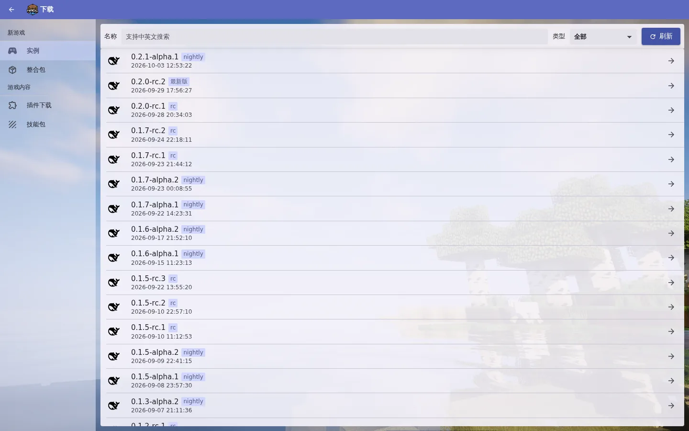
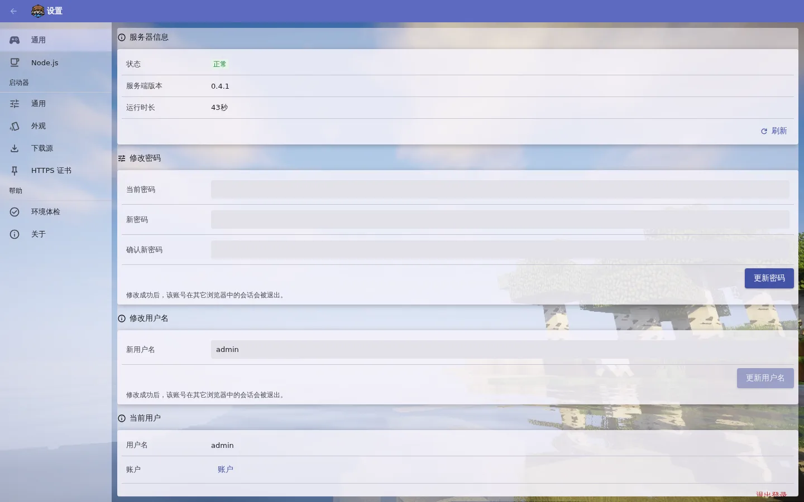

# HDSL-web

[](https://github.com/nas200-timmy/HDSL-WEB/actions/workflows/build.yml)
[](https://github.com/nas200-timmy/HDSL-WEB/actions/workflows/docker.yml)
[](https://github.com/nas200-timmy/HDSL-WEB/releases)
[](https://github.com/nas200-timmy/HDSL-WEB/pkgs/container/hdsl-web)
[](LICENSE)
[]()

把 [HDSL](https://github.com/MCXCC303/HDSL)（Hello DeepSeek! Launcher，桌面版）搬进浏览器的单容器版本：
打开网页 → 登录 → 创建 dsh 实例 → 点「启动」→ 在同一域名、端口与证书下使用 dsh 自己的网页界面。
界面按桌面版复刻（HMCL 视觉语言、Material You 主题、同款图标与动画），实例/版本/插件/账户/整合包/
会话/技能/体检/ACP 控制台都在。



- 交付：一个可执行 fat jar（`java -jar hdsl-web.jar`）和一个 Debian 容器镜像。
- 运行前提：JDK 17+；Node `^22.19.0 || >=24.0.0` 与 pnpm（dsh 由 pnpm 安装、由 node 运行）。
- 手机可用：窄屏（≤760px）或矮屏（≤520px）自动切换移动版式——主导航收成抽屉、内页子侧栏变
  顶部横向标签条、启动面板变成贴底整条操作栏；可点区域按触摸标准放大到 44px，支持「加到主屏幕」。
  桌面上版式不变。规则见 [docs/ui-spec.md §14](docs/ui-spec.md)。
- 账户：为某个模型供应商填一次 API Key。供应商与模型名来自 [models.dev](https://models.dev)
  目录（200+ 家，选中供应商即带出端点、协议与密钥环境变量提示），默认模型可搜索也可手输；
  目录拉不到时退回纯手输。规则见 [docs/ui-spec.md §4](docs/ui-spec.md)。
- 创建实例即开始安装；未安装的实例点「启动」会先装再启。进度与失败原因都在面板上。
  细节见 [docs/launcher-orchestration.md](docs/launcher-orchestration.md)。
- 品牌：除 dsh 外，还能在面板里安装第三方网页工作台：Kimi Code、OpenCode、Claude Web（实验性）。
  入口在实例列表页左侧「第三方品牌」。每个品牌可以开多个实例，版本按品牌共享——装一次，同品牌的
  所有实例都能切换过去。完整说明见 [docs/brands.md](docs/brands.md)。
- 下载源：设置页可选择预设镜像（npmmirror / 中科大 / 腾讯云 / 华为云 / 官方）或手填 URL。
  保存后立即生效，无需重启。环境变量 `NPM_CONFIG_REGISTRY` 仅作为回退值。
  细节见 [docs/deployment.md](docs/deployment.md)。
- **实例终端（Web Shell）**：实例行上的「终端」按钮就地打开该实例的原生 TUI——Kimi Code、
  OpenCode，以及 dsh 的 `dsh tui [--resume]`。终端跑在面板进程里、走现有 WebSocket，不新增
  端口、不需要反向代理；关窗/刷新只断开查看，agent 继续跑，重开接回并回放。同一份实例 home
  与会话记录，和网页模式看到的是同一份。打开需要开发者密码；细节与威胁模型见
  [docs/web-shell.md](docs/web-shell.md)。

<details>
<summary>更多截图（初始化引导 / 实例列表 / 品牌实例 / 下载 / 设置）</summary>

| 初始化引导（首启建号） | 实例列表 |
|---|---|
|  |  |

| 品牌实例（实例列表页内原地切换） |
|---|
|  |

| 下载（真实 npm 版本列表） | 设置 |
|---|---|
|  |  |

</details>

## 目录

- [架构](#架构)
- [实例终端（Web Shell）](#实例终端web-shell)
- [快速开始](#快速开始)（Release 下载 / Docker Compose / 裸 `java -jar`）
- [首次登录与初始化引导](#首次登录与初始化引导)
- [数据与挂载点](#数据与挂载点)
- [声明式 HTTPS](#声明式-https)
- [环境变量](#环境变量)
- [反向代理](#反向代理)
- [安全说明](#安全说明)
- [构建与开发](#构建与开发)
- [常见问题](#常见问题)
- [设计说明](docs/design-notes.md)
- [许可](#许可)

## 架构

```
浏览器标签页 A：HDSL 面板            浏览器标签页 B：dsh web
   https://host:3080（同一张证书、同一端口）
        │                                   │
        ▼                                   ▼
┌─ 单个容器（HDSL-web）────────────────────────────────────────┐
│  Jetty 边缘（一个 JVM 进程，监听 0.0.0.0:3080）               │
│   ├─ SPA 静态资源（React 构建产物，已打进 jar）               │
│   ├─ /api/*       REST（认证/实例/版本/插件/账户/整合包/…）   │
│   ├─ /ws          WebSocket（日志流、任务进度、状态事件）      │
│   ├─ /ws/terminal WebSocket（原地终端：实例原生 TUI）          │
│   └─ /i/{id}/*    反向代理 → 127.0.0.1:3081-4081             │
│  Java 领域层（自 HDSL 移植）：实例、版本、插件、账户、整合包   │
│  dsh 实例进程池：node bin.js --profile web --port N …        │
│  伪终端：kimi / opencode / dsh tui（按实例，随面板退出）      │
│  容器内置 OpenJDK 21 + Node ^22 + pnpm(通过 corepack)         │
└───────────────────────────────────────────────────────────────┘
        │  卷：hdsl-data → /data（唯一需要持久化的目录）
        ▼
```

面板与 dsh 是两个彼此独立的页面：面板负责启动和停止，使用在 dsh 自己的页面里。前面再放一层
nginx/Caddy 也支持，`Host` 必须原样透传。细节见 [docs/deployment.md](docs/deployment.md) 与
[docs/design-notes.md](docs/design-notes.md)。

## 实例终端（Web Shell）

实例行上的「终端」按钮打开该实例的原生 TUI（Kimi Code、OpenCode、`dsh tui`），在当前页面
原地覆盖，不跳路由：

- **以实例为单位**：同一份 home、账号与模型路由，TUI 里能 resume 的会话与网页模式一致。
- **会话常驻**：关窗/刷新只 detach，agent 继续跑；重开接回并回放最近 256 KB。`/exit`、
  底栏「停止」、实例停止才杀进程树；同一实例同时只有一个会话。
- **两道门**：面板会话 + 开发者密码提权（15 分钟滑动）。首次打开时可直接在终端窗口里设置
  开发者密码（要面板密码确认）。
- **可关闭**：设置 →「开发者模式」（这一页本身也要开发者密码）里有一个 Web Shell 总开关。
  关掉后实例列表不再显示终端按钮，直接调接口返回 403 `web_shell_disabled`；已经打开的终端
  不受影响，可以从它自己的窗口停止。
- **Windows**：不走浏览器 PTY，而是在桌面会话里开一个控制台窗口；面板以服务运行时没有交互
  桌面，按钮会明确拒绝。

终端入口效果上等价于 RCE（它启动的是 agent 进程），部署前提与威胁模型见
[docs/web-shell.md §4.1](docs/web-shell.md)。这是面板里唯一的 TUI 入口——SSH 通道已在
v0.6.0 移除。

## 快速开始

### 方式零：下载 Release 产物

从 [Releases](https://github.com/nas200-timmy/HDSL-WEB/releases) 下载 `hdsl-web-<版本>.jar`
以及 `SHA256SUMS.txt`：

```bash
sha256sum -c SHA256SUMS.txt
HDSL_DATA="$PWD/data" HDSL_PORT=3080 java -jar hdsl-web-<版本>.jar
```

jar 的运行前提见「方式二」（JDK 17+ 与 Node/pnpm）。Docker 部署推荐用方式一。

### 方式一：Docker / Compose（推荐）

镜像发布在 GitHub Container Registry，`linux/amd64` 与 `linux/arm64` 双架构，`docker pull`
会按机器自动选择：

```bash
docker pull ghcr.io/nas200-timmy/hdsl-web:latest

docker run -d --name hdsl-web --restart unless-stopped \
  -p 3080:3080 \
  -v hdsl-data:/data \
  -e HDSL_ADMIN_PASSWORD='换成一个强口令' \
  ghcr.io/nas200-timmy/hdsl-web:latest
```

版本化标签与 Release 一一对应（如 `ghcr.io/nas200-timmy/hdsl-web:0.5.21`）。从源码构建：

```bash
cd HDSL-web

# 可选：首次启动的管理员口令（不设则首次打开网页时创建管理员账号）
export HDSL_ADMIN_PASSWORD='换成一个强口令'
docker compose up -d --build
```

打开 `http://<主机>:3080`：设了 `HDSL_ADMIN_PASSWORD` 就用 `admin` + 该口令登录；否则自动进入
初始化引导页，设置用户名和密码后即创建账号并进入面板。默认是纯 HTTP；要 HTTPS 见
[声明式 HTTPS](#声明式-https)。

### 方式二：裸 `java -jar`（不用 Docker）

前提：JDK 17+、Node `^22.19.0 || >=24.0.0`、pnpm（`corepack enable pnpm`，或 `npm i -g pnpm`）。
Node 版本范围是 dsh 自己的 `engines` 要求；pnpm 既是 dsh 的安装器，也是插件管理的转发目标。

Windows 同样可用：面板认得出系统装的 Node.js（`node.exe` / `npm.cmd` / `pnpm.cmd`）、能装 dsh
版本与插件、能装品牌工具、能一键装托管 Node 运行时、能在面板内构建 ZCode。实例终端在
Windows 上走桌面控制台——面板必须在控制台或 RDP 会话里运行；以服务运行（session 0）时没有
交互桌面，终端与「打开文件夹/日志」会明确返回 409。会话租约观察仍不支持。NTFS 也没有
`0600` 语义（见
[安全说明](#安全说明)）。逐条实测与限制见 [docs/windows-bare-deploy.md](docs/windows-bare-deploy.md)。

```bash
./gradlew shadowJar
# 产出 build/libs/hdsl-web-<版本>.jar

HDSL_DATA="$PWD/data" \
HDSL_PORT=3080 \
HDSL_ADMIN_PASSWORD='换成一个强口令' \
  java -jar build/libs/hdsl-web-0.1.0-dev.jar
```

```powershell
# Windows（PowerShell）
.\gradlew.bat shadowJar

$env:HDSL_DATA = "$PWD\data"
$env:HDSL_PORT = "3080"
$env:HDSL_ADMIN_PASSWORD = "换成一个强口令"
java -jar build\libs\hdsl-web-0.1.0-dev.jar
```

Windows 上有两个目录，别混：

- 启动器用户目录 `%APPDATA%\.hdsl`（可用 `-Dhdsl.home=` 或 `HDSL_USER_HOME` 覆盖）：实例、
  运行时装在这里，不受「从哪双击启动」影响。
- 面板数据目录 `HDSL_DATA`（默认 `./data`，相对当前工作目录）：账号、配置、证书、pnpm store
  在这里。裸部署建议显式设一个绝对路径。

不用环境变量也行：`hdsl-web` 会读 `$HDSL_DATA/server.yaml`（默认 `./data`），没有配置文件就用
内置默认值。`java -jar … -version` 只打印版本号后退出。

### 首次登录与初始化引导

- 设了 `HDSL_ADMIN_PASSWORD`：首次启动自动创建 `admin` 账号，直接登录；重启不会重置已存在的口令。
- 没设：服务端不生成任何密码，保持「待初始化」；打开网页进入引导页，填写用户名（1–32 位、不含
  空白）和密码（至少 6 位）后点击「创建并进入」，创建成功即自动登录。
- 引导页只在没有任何用户时可用（`GET /api/auth/status` 的 `setupRequired` 为 true）；之后访问
  会被拒绝（409），正常走登录页。
- 已初始化后可在「设置 → 通用 → 修改密码」更换密码；修改成功后其它浏览器中的会话会被退出
  （当前会话保留）。

## 数据与挂载点

容器里有一个必须挂的挂载点，另有一个可选的工作区：

| 挂载点 | 必须？ | 内容 |
|---|---|---|
| `/data` | 必须持久化 | 面板的全部状态：配置、口令、证书、实例、`DSH_HOME`、pnpm store |
| `/home/hdsl/workspace` | 可选 | dsh 的工作区：会话读写文件的地方，也是 dsh 进程的工作目录。不挂就是容器内目录（重建会丢）；挂了就随你（宿主目录 = dsh 直接编辑真实文件，命名卷 = 留在容器外） |

`HDSL_DATA`（容器内固定为 `/data`）是必须持久化的目录。dsh 实例的 `DSH_HOME`、pnpm store 都在
它下面，所以「挂一个卷、备份一个目录」就覆盖全部状态。

| 路径 | 内容 | 需要备份 |
|---|---|---|
| `/data/server.yaml` | 声明式配置（监听、HTTPS、认证），可手写，也可由面板证书上传回写 | 是 |
| `/data/certs/` | TLS 身份：上传的 `uploaded.pem`/`uploaded.key` 或 `uploaded.p12`；首启自签是 `self-signed.pem`/`self-signed-key.pem` | 是 |
| `/data/auth/users.json` | 管理员账号的口令哈希 | 是 |
| `/data/logs/` | 服务端日志 | 否 |
| `/data/tmp/` | 上传暂存（插件 `.tgz`、证书、整合包 `.dspack`） | 否 |
| `/data/exports/` | 导出的整合包产物（`GET /api/exports` 列出的就是它） | 否 |
| `/data/hdsl/` | `hdsl.home`：启动器自己的全部状态（可用 `-Dhdsl.home=` 覆盖） | 是 |
| `/data/hdsl/launcher-settings.json` | 启动器设置（代理、并发、下载源、隔离模式、工作区选择等） | 是 |
| `/data/hdsl/instances/<id>/` | 每个实例：`instance.json`、`dsh/`、`home/` | 是 |
| `/data/hdsl/homes/<版本>/` | 共享隔离模式下多个实例共用的 home | 是 |
| `/data/hdsl/runtimes/<版本>/` | 自下载的 Node 运行时；镜像已内置 Node，通常为空 | 否 |
| `/data/hdsl/catalog/` | 远程目录缓存（快速安装预设、models.dev，12 小时 TTL） | 否 |
| `/data/hdsl/logs/` | 从日志窗口导出的日志文件 | 否 |
| `/data/pnpm-store/` | pnpm 共享仓库（`storeDir`），多实例装同一个包时硬链接复用 | 否（可重建） |
| `/data/corepack/` | corepack 缓存（`COREPACK_HOME`） | 否 |

工作区是 dsh 会话的「项目根」，不是面板放实例的目录。要持久化或让 dsh 直接编辑宿主机目录，
取消 compose 里对应那行的注释：`- /srv/dsh-workspace:/home/hdsl/workspace`（让 uid/gid 1000
可读写）或 `- hdsl-workspace:/home/hdsl/workspace`（命名卷）；也可以用 `HDSL_WORKSPACE` 指到
别的已挂路径。已有实例保留创建时记录的工作区，新建的才用新的。

备份与迁移的做法：停容器 → 整个拷走 `/data`；工作区挂了卷就一起拷。恢复同理。细节见
[docs/deployment.md](docs/deployment.md)。

## 声明式 HTTPS

配置优先级：环境变量 > `server.yaml` > 内置默认值。`server.yaml` 的每个键都可选；写错或写了
非法值会启动失败并指出是哪一行/哪个字段。

```yaml
# <HDSL_DATA>/server.yaml
bind_host: 0.0.0.0        # 默认 0.0.0.0
port: 3080                # 默认 3080；HTTPS 启用时同一端口直接说 TLS
public_base_url: https://dsh.example.com   # 反代后的公网基址；用于自签证书的 SAN 与 --trusted-host

https:
  enabled: true           # 默认 false（纯 HTTP，仅建议回环）
  # 方式 A：PEM 证书链 + 私钥（相对路径按 HDSL_DATA 解析，也可写绝对路径）
  cert_file: certs/fullchain.pem
  key_file:  certs/privkey.pem
  # 方式 B：PKCS#12；同时配置时 PKCS#12 优先
  pkcs12_file: certs/site.p12
  pkcs12_password: "…"
  redirect_same_port: true  # 默认 true：TLS 端口同时接明文请求，一律 308 跳到 HTTPS
  redirect_http: false    # true = 另开一个纯 HTTP 端口，把所有请求 308 到同主机的 HTTPS
  redirect_port: 80       # 上面那个 HTTP 端口，默认 80

auth:
  disabled: false         # true 只有 bind_host 是回环地址时才允许（开发用）
  session_ttl_hours: 168  # 会话有效期，滑动续期，默认 168 小时（一周）
```

### 两步启用 HTTPS

1. 首启自签：把 `https.enabled` 设为 `true`（或 `HDSL_HTTPS=true`）而不配证书，第一次启动会
   自动生成自签证书放进 `/data/certs/`。可以直接用，浏览器会告警（点继续即可）。
2. 面板上传证书，热切换：登录后进「设置 → TLS 证书」，上传 PEM（证书链 + 私钥）或 `.p12`
   （+ 口令）。选择会写回 `server.yaml`，然后在不重启、不换端口的前提下换掉身份；运行时切换
   失败会回滚为明文并返回 `restartRequired: true`，重启容器即应用。

自签证书的 SAN 会带上 `public_base_url` 的 host、`localhost`/`127.0.0.1`、本机所有网卡地址与
主机名——没有域名、直接用 `https://<IP>:3080` 打开也不会证书域名不匹配。

### 用 IP 直连是正常用法

没有域名、没有反代、也不想暴露到公网的部署，地址就是那串 IP。HTTPS 打开后：

- 同一个 TLS 端口也接明文（`redirect_same_port`，默认开）：明文请求一律回
  `308 Location: https://<同主机>:<同端口><同路径>`；内容永远不会以明文发出。
- 想只认 TLS：把 `redirect_same_port` 设为 `false`。想再开一个固定明文端口做跳转：
  `redirect_http: true` + `redirect_port`。

机制与回滚细节见 [docs/design-notes.md](docs/design-notes.md)。

## 环境变量

| 变量 | 默认 | 作用 |
|---|---|---|
| `HDSL_DATA` | `./data`（镜像内 `/data`） | 数据目录；`server.yaml`、证书、实例、pnpm store 都在它下面 |
| `HDSL_PORT` | `3080` | 主监听端口。HTTPS 启用时是同一个端口；`0` 表示让系统随机选（测试用） |
| `HDSL_BIND_HOST` | `0.0.0.0` | 主监听地址。只想本机访问可设 `127.0.0.1` |
| `HDSL_BASE_PATH` | 空 | 面板被反代在子路径下时的挂载前缀（如 `/panel`）。反代须剥前缀，见[反向代理](#反向代理) |
| `HDSL_HTTPS` | `false` | 只接受 `true`/`false`；等价于 `https.enabled` |
| `HDSL_WEB_SHELL_ENABLED` | `true` | 实例终端（Web Shell）总开关；等价于 `server.yaml` 的 `web_shell.enabled`。关掉后终端按钮隐藏、打开接口返回 403。设置页「开发者模式」也能改 |
| `HDSL_ADMIN_PASSWORD` | 空 | 仅首次启动且数据目录里没有用户时，用它创建 `admin` 账号；已存在账号时忽略 |
| `NPM_CONFIG_REGISTRY` | `https://registry.npmjs.org/` | 下载源的回退值；面板设置优先。面板里改完立即生效，改环境变量要重启容器 |
| `JAVA_OPTS` | 空 | 追加到 `java` 命令行的 JVM 参数，例如 `-Xmx2g` |
| `PNPM_STORE_DIR` | `/data/pnpm-store` | pnpm 共享仓库位置（入口脚本会写进 pnpm 配置）；一般不用改 |
| `HDSL_WORKSPACE` | 空 | dsh 工作区路径。不设时用 `$HOME/workspace`（镜像内 `/home/hdsl/workspace`）；新建实例默认用它 |
| `HDSL_ZCODE_PACKAGE` | 空 | 实验性 ZCode 的发行包目录（需含 `bin/zcode.mjs`）；不设时找 `<数据目录>/zcode/current/`。见 [docs/zcode-experimental.md](docs/zcode-experimental.md) |
| `HDSL_ZCODE_NODE` | 空 | 跑 ZCode 用的 node；不设时用 PATH 上的 `node` |

`HDSL_BIND_HOST` / `HDSL_PORT` / `HDSL_HTTPS` 之外的一切（证书路径、`auth.disabled`、
`redirect_same_port` 等）都从 `server.yaml` 读。dsh 实例端口从 3081–4081 分配、终身绑定，只
监听回环，不对外发布。

环境变量盖过 `server.yaml`：镜像里已经设了 `HDSL_PORT=3080`，想换端口要改 `HDSL_PORT`（改
`server.yaml` 的 `port` 会被忽略）；要用 `server.yaml` 的 `port` 就把 `HDSL_PORT` 显式清空。

ZCode 是实验性品类，不在稳定性承诺内；定位、构建方式与限制见
[docs/zcode-experimental.md](docs/zcode-experimental.md)。pnpm 的配置为什么不能只靠环境变量，
见 [docs/design-notes.md](docs/design-notes.md) 的「下载源与 pnpm 配置」。

## 反向代理

面板本身可以被 nginx / Caddy / 网关架在域名后面。两种挂法都实测过（SPA、登录、API、WebSocket、
品牌实例 `/i/<id>/`、壁纸资产全链路）。

根路径挂载（推荐，零配置）：

```nginx
location / {
    proxy_pass http://127.0.0.1:3080;
    proxy_set_header Host $host;
    proxy_http_version 1.1;
    proxy_set_header Upgrade $http_upgrade;
    proxy_set_header Connection "upgrade";
}
```

子路径挂载：面板设 `HDSL_BASE_PATH=/panel`，反代剥前缀转发：

```nginx
location /panel/ {
    proxy_pass http://127.0.0.1:3080/;    # 尾部斜杠 = 剥掉 /panel 前缀
    proxy_set_header Host $host;
    proxy_http_version 1.1;
    proxy_set_header Upgrade $http_upgrade;
    proxy_set_header Connection "upgrade";
}
```

两种挂法都必须透传 WebSocket 升级头，否则实例列表、任务进度和品牌实例状态不会刷新（页面其余
功能不受影响）。剥前缀、`Host` 透传与 `<base href>` 的机制见
[docs/design-notes.md](docs/design-notes.md)。

## 安全说明

> Windows 没有 POSIX 的 0600 语义：多用户机器上，凭据文件可能被同机其他账户读到。按单用户
> 机器对待，并且不要把数据目录暴露到公网可访问的位置。

- 登录门：`POST /api/auth/login`、`GET /api/auth/status`、`POST /api/auth/setup`（仅无用户时）
  与 `GET /api/health` 是公开的（外加不含数据的 SPA 外壳）；`/api/*`、`/ws`、`/i/*` 都要求会话。
  改密码或改用户名后，同用户的其它会话立即失效（改名的那个会话保留并切换到新用户名）。
- 登录失败有预算：**同一来源地址**五分钟内 15 次失败之后，第 16 次起拒绝十分钟（响应带
  `Retry-After`，说明还要等多少秒），期间口令正确也一样进不来；一次成功即清零。预算没花完之前
  页面上不提示任何计数——只有真的被挡住时才说出来。拒绝发生在核对口令**之前**：核对口令本身
  （PBKDF2 二十一万次）就是攻击者想花掉的那笔开销。来源地址取的是 TCP 对端地址，所以面板如果
  架在反向代理后面，这个预算是所有访问者共用的（`X-Forwarded-For` 是客户端能自己写的，不能信）。
- 口令用 PBKDF2WithHmacSHA256（per-user 盐、21 万次迭代），文件原子写入并尽量收紧到 0600。
- **实例终端是一个能执行 agent 的入口，效果上等价于 RCE**：除了会话，还要开发者密码提权
  （15 分钟滑动）；Windows 桌面启动额外要求字面确认。面板只应监听回环或可信网络；要暴露
  公网必须在网络层再加保护。见 [docs/web-shell.md §4.1](docs/web-shell.md)。
- dsh 只监听回环；TLS 在面板边缘终结，外部能到达的只有面板端口。
- 点「停止」会杀整棵进程树：端口立刻关闭，`/i/<id>/` 立刻不可用。dsh 的访问 token 每进程随机、
  只存内存、重启即换。
- 面板 Cookie 是 `HttpOnly` + `SameSite=Strict`，HTTPS 下加 `Secure`；反代把 dsh 的 Cookie
  Path 改写到 `/i/<id>/`，多实例不会互相覆盖。
- `auth.disabled: true` 只在绑定回环地址时允许。
- 首启自签证书会让浏览器告警，这是预期行为；正式使用请上传受信任的证书。

实现细节见 [docs/design-notes.md](docs/design-notes.md)。

## 构建与开发

```bash
# 后端：编译 + 全部测试（JUnit 5）
./gradlew build

# 只跑测试
./gradlew test

# 单个 jar（SPA 会被打进 jar）
./gradlew shadowJar
# → build/libs/hdsl-web-<版本>.jar（版本由 -PreleaseVersion=1.2.3 决定，缺省 0.1.0-dev）

# 前端开发服务器（默认 5173，把 /api /ws /i 代理到 127.0.0.1:3080）
cd web && npm install && npm run dev
cd web && npm run build

# 容器
docker build -t hdsl-web .
docker compose up -d

# 端到端冒烟：真实 npm 安装 dsh → 启动 → 反代访问 → 停止后确认 /i/ 404
bash scripts/e2e-real.sh
```

第一次 `./gradlew build` / `shadowJar` 之前先 `cd web && npm install`：只要 PATH 上有 npm，
Gradle 就会执行 `npm run build`，没有 `node_modules` 会失败。Docker 构建不需要——镜像的
build 阶段故意不带 npm，SPA 由单独的 web 阶段产出后拷进去。

`scripts/e2e-real.sh` 会真的访问 npm registry、装一个 dsh 版本并启动，耗时几分钟，需要网络。
`scripts/` 下还有什么、各自验什么、怎么跑，见 [scripts/README.md](scripts/README.md)。
开发时的分工是：先起后端（3080），再 `npm run dev`，浏览器开 5173；后端没起时页面会报连接/
登录失败，属预期。

兼容底线与 CI 闸门见 [docs/compatibility.md](docs/compatibility.md)。

## 常见问题

浏览器提示证书不安全。首启用的是自签证书，属正常。点「继续访问」，或到「设置 → TLS 证书」
上传正式证书（立即生效，无需重启）。

npm / pnpm 下载很慢。首选「设置 → 下载源」：选预设（`npmmirror` / 中科大 / 腾讯云 / 华为云 /
官方）或填自己的镜像 URL，保存即生效、不用重启容器。没有面板可点的时候（裸跑、无人值守部署）再
用环境变量：运行时设 `NPM_CONFIG_REGISTRY`；构建镜像时用 `--build-arg NPM_REGISTRY=…`（只影响
构建期）。面板设置压过环境变量，环境变量只是回退值。细节见
[docs/deployment.md](docs/deployment.md)。

端口被占用。面板端口冲突改 `ports` 映射和 `HDSL_PORT`；dsh 实例用的 3081–4081 只在容器内回环，
不占宿主机端口。

实例启动后立刻消失，或一直停在「启动中」、`/i/<id>/` 返回 502。先查内核的
`fs.inotify.max_user_watches` 配额——dsh 启动要监视 profile 目录，配额不足时 node 会静默退出或
不打印就绪行。面板「设置 → 环境体检」的 File watchers 一行会直接标出是否不足，调大办法见
[docs/deployment.md](docs/deployment.md#8-宿主-inotify-配额多实例)。

pnpm store 想放到别处。改 `PNPM_STORE_DIR`（入口脚本会写进 pnpm 配置）。store 与实例目录要在
同一文件系统上，否则 pnpm 只能复制、不能硬链接；默认两者都在 `/data` 下。

裸跑时数据放在哪。默认 `./data`；用 `HDSL_DATA` 指定。`hdsl.home` 自动取 `<HDSL_DATA>/hdsl`，
也可以用 `-Dhdsl.home=/path` 覆盖（优先级更高）。

用 bind mount 而不是命名卷时权限报错。容器里的运行用户是 `hdsl`（uid/gid 1000），绑定的宿主
目录必须让它可写：`sudo chown -R 1000:1000 ./data`。命名卷没有这个问题。

日志在哪。容器里看 `docker compose logs -f hdsl-web`；服务端日志同时落在 `/data/logs/`，实例
运行日志从面板的「日志」标签看，导出目录是 `/data/hdsl/logs/`。

装某个插件时报 node-gyp / 找不到编译器。镜像已带 `python3` / `make` / `g++`（面板内构建 ZCode
时也要用），`git`、`xz-utils`、`zstd` 也都装了。仍然报缺编译器时先看它要的是不是别的东西
（`cmake`、`pkg-config` 之类），再基于本镜像加一层补装。

改了 `server.yaml` 要重启吗。手改文件需要重启。面板上传证书不需要（热重载/运行时切换）。

## 许可

HDSL-web 以 GNU GPL v3（或更新版本）发布，见 [LICENSE](LICENSE)。

本项目是 [HDSL](https://github.com/MCXCC303/HDSL) 的 Web 服务端衍生版，而 HDSL 又是
[Hello Minecraft! Launcher (HMCL)](https://github.com/HMCL-dev/HMCL) 的修改版：
领域层（`dsh/`、`setting/`、`util/`）自 HDSL 拷贝并去除 JavaFX 依赖，保留原包名、版权头与 GPL
授权。修改说明、商标与第三方组件（Jetty、Bouncy Castle、snakeyaml-engine、Gson、SLF4J、
kala-compress、Node.js、pnpm 等）的授权声明见 [NOTICE](NOTICE)。

「DeepSeek」「DeepSeek Harness」「dsh」归其各自权利人所有；HDSL-web 是独立的非官方项目，与
DeepSeek Harness 项目无隶属或背书关系。
