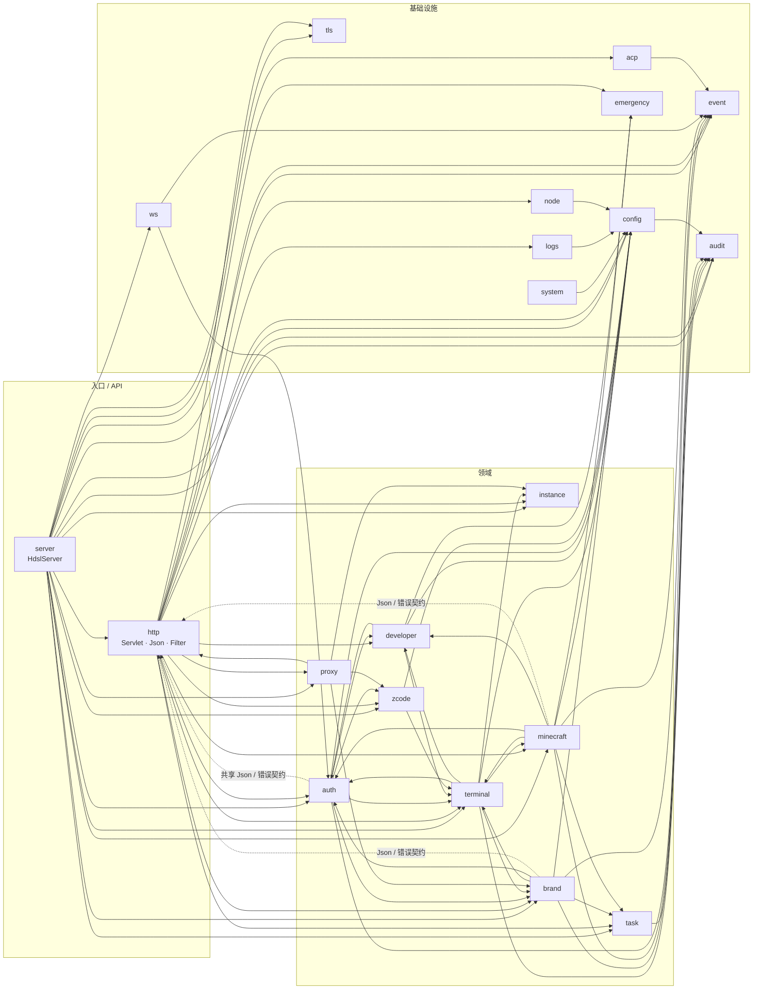

# 后端包依赖

这是 **import 级近似图**，不是严格的 DAG。`http` 既是 API 聚合层，又提供 `Json`、`HostHeaders`、错误契约等共享类型，所以它和 `auth`、`brand`、`minecraft` 之间存在回边；`terminal`、`proxy` 也需要知道领域运行时的存在。图的价值是看**大方向**，不是拿来卡每一条 import。

## 层的意图

| 层 | 包 | 职责 |
|---|---|---|
| 入口 | `server` | 装配 Jetty、Filter、Servlet、运行时；只做 wiring |
| API | `http` | REST 路由、请求解析、错误 JSON、鉴权后的业务编排 |
| 认证 | `auth`、`developer` | 会话、用户、提权、Agent 票据、scope、PeerIdentity |
| 实例 | `instance`、`brand`、`minecraft`、`zcode` | 四类运行时的生命周期、安装、日志、端口 |
| 终端 | `terminal` | TUI 适配、PTY、ticket、终端管理器 |
| 反代 | `proxy` | `/i/*` HTTP/WS 中继、目标端口解析 |
| 任务 | `task` | 长任务、进度、取消、审批 |
| 基础设施 | `config`、`event`、`audit`、`logs`、`system`、`tls`、`ws`、`node`、`emergency`、`acp` | 配置、事件、审计、日志、指标、TLS、WebSocket、Node、急停、ACP |

## 已知回边

这些回边是有意的，不要为了“消除循环”做大规模重构：

- `http ↔ auth / brand / minecraft`：Servlet 调领域，领域也用 `http.Json`、`HostHeaders`、错误契约。
- `terminal → brand / minecraft / instance`：TUI 适配器必须知道对应实例的 HOME、workspace、启动参数。
- `proxy → brand / zcode / instance`：反代要先解析目标端口，不能只依赖一个通用接口。
- `brand / minecraft → task / terminal`：安装是长任务，启动后要能接终端。
- `auth → developer`：会话和提权共用同一套身份；`developer → auth` 再用会话做二次确认。

新增依赖时先问一句：这是“领域需要基础设施”，还是“基础设施反向知道了领域”？后者通常应该通过 `EventBus`、`TaskService` 回调或一个窄接口解决。
