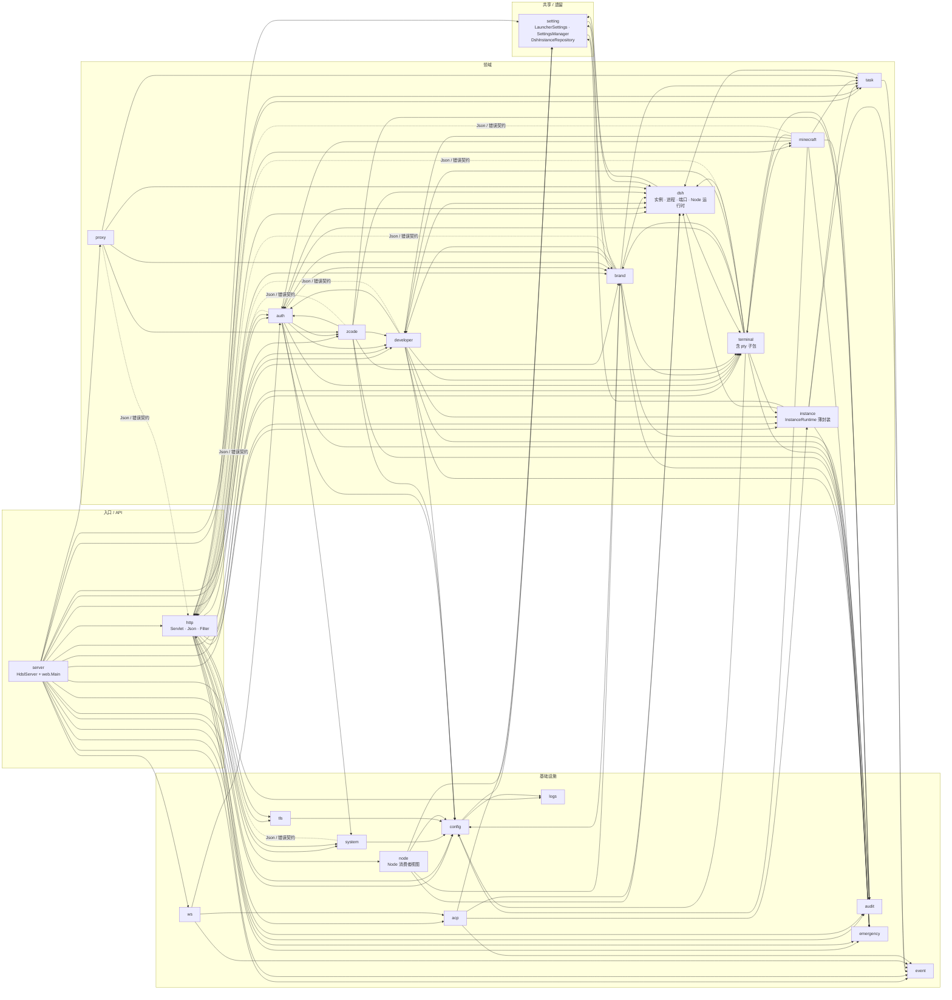

# 后端包依赖

这是 **import 级近似图**，不是严格的 DAG。`http` 既是 API 聚合层，又提供 `Json`、`HostHeaders`、错误契约等共享类型，所以它和 `auth`、`brand`、`minecraft` 等之间存在回边；`terminal`、`proxy` 也需要知道领域运行时的存在。图的价值是看**大方向**，不是拿来卡每一条 import。

统计口径：只算 `import` 与代码里的全限定引用。javadoc 的 `{@link}` 不算——否则 `brand → zcode`、`terminal → zcode`、`emergency → developer`、`audit → server` 这类只出现在注释里的“依赖”会混进来，图就变成谎言了。

## 层的意图

| 层 | 包 | 职责 |
|---|---|---|
| 入口 | `server`（+ `web.Main`） | 装配 Jetty、Filter、Servlet、运行时；只做 wiring |
| API | `http` | REST 路由、请求解析、错误 JSON、鉴权后的业务编排；另外导出 `Json`、`HostHeaders` 供各领域复用——图中那些虚线回边就是这一层 |
| 认证 | `auth`、`developer` | 会话、用户、提权、Agent 票据、scope、PeerIdentity |
| 实例 | `dsh`、`instance`、`brand`、`minecraft`、`zcode` | 五类运行时的领域模型与生命周期。`dsh` 是面板最早支持的运行时，也是最大的一类（实例、进程、端口、`NodeRuntimeManager`、`DshPaths`、`skin` 子包），`instance` 只有 `InstanceRuntime` 一层封装 |
| 终端 | `terminal`（含 `pty`） | TUI 适配、PTY、ticket、终端管理器 |
| 反代 | `proxy` | `/i/*` HTTP/WS 中继、目标端口解析 |
| 任务 | `task` | 长任务、进度、取消、审批 |
| 共享 / 遗留 | `setting` | `LauncherSettings`、`SettingsManager`、`GameDirectory`、`DshInstanceRepository`——HMCL 遗留，被 dsh 与品牌两侧共用 |
| 基础设施 | `config`、`event`、`audit`、`logs`、`system`、`tls`、`ws`、`node`、`emergency`、`acp` | 配置、事件、审计、日志、指标、TLS、WebSocket、Node 消费者视图、急停、ACP |

两个容易看错的地方：

- **`node` 不是托管管理器。** `web/node/NodeEnvironment` 只回答“哪个实例 / 品牌实例 / ZCode 构建用哪个 Node”，是 Node 页的只读视图；下载与版本管理在 `dsh/NodeRuntimeManager`。这也是 `node → brand` 那条边存在的原因。
- **`dsh` 不在 `web` 包下**，但它是 Web 面板的领域层，不是“第三方库”。改实例生命周期、端口池、Node 解析，先看 `org.jackhuang.hmcl.dsh`，不要从 `web/instance` 找。
- `desktop`（Windows 打开资源管理器 / 记事本）只被 `brand` 和 `http` 引用，太小，没有单独画成一个包。

## 已知回边

这些回边是有意的，不要为了“消除循环”做大规模重构：

- `http ↔ auth / developer / brand / minecraft / zcode / terminal / proxy / system`：Servlet 调领域，领域也用 `http.Json`、`HostHeaders`、错误契约。图中虚线就是这一类“共享类型”依赖，不是业务回调。
- `setting ↔ dsh`：`DshInstanceRepository` 把 dsh 实例落盘，dsh 又读 `LauncherSettings`；`setting → brand` 同理，品牌实例的落盘索引也在那里。
- `terminal → brand / minecraft / instance / dsh`：TUI 适配器必须知道对应实例的 HOME、workspace、启动参数。
- `proxy → brand / dsh / zcode`：反代要先解析目标端口，不能只依赖一个通用接口。**`proxy` 不认识 `instance`**——dsh 的目标解析走 `DshProcessManager`。
- `brand / minecraft → task / terminal`、`zcode → terminal`：安装是长任务，启动后要能接终端。
- `auth → developer` ↔ `developer → auth`：会话和提权共用同一套身份，提权再拿会话做二次确认。
- `config → logs`：日志目录与保留天数（`LogRetention`）都来自配置，`logs` 不反向依赖 `config`。
- `node → brand`：Node 页按品牌实例列消费者，读 `BrandPolicy` 的默认选择。
- `instance → task / event / emergency`：启动前看急停，长任务和事件由这层转发。
- `acp → dsh / instance`：ACP 桥接要把会话落回具体实例。

新增依赖时先问一句：这是“领域需要基础设施”，还是“基础设施反向知道了领域”？后者通常应该通过 `EventBus`、`TaskService` 回调或一个窄接口解决。
