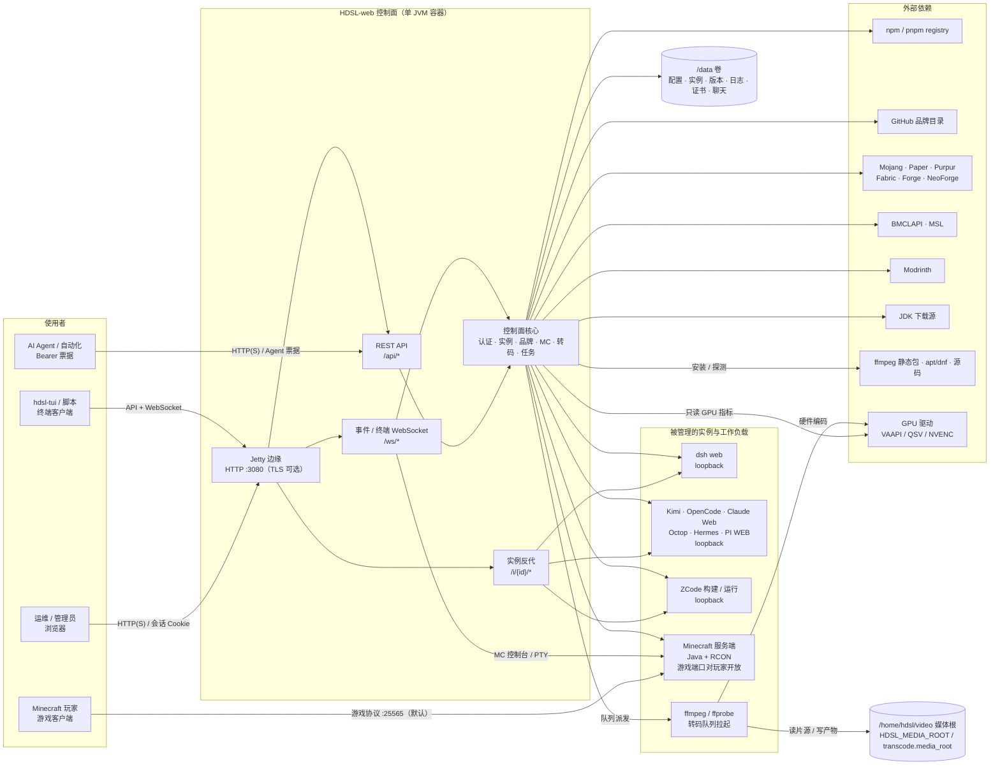

# 系统上下文（战略）

这张图只回答“系统边界在哪里”：谁是使用者、面板控制什么、实例在哪里跑、外部依赖有哪些、什么东西必须持久化。Servlet、TaskService、PTY 这些实现细节放在 [full.md](full.md)。

## 边界

- **控制面**是面板本身：认证、实例生命周期、版本/插件/下载源、任务、审计、终端票据、转码队列。它运行在一个 JVM 里，对外只暴露 `:3080`——默认是明文 **HTTP**；`https.enabled` 打开后才是 HTTPS（证书由 `CertificateManager` 管理，自签也行）。
- **数据面**分两类通道，不要混为一谈：
  - dsh / 品牌 / ZCode 只监听 loopback，浏览器经 `/i/{id}/` 反代或 `/ws/terminal/{ticket}` 终端访问它们；
  - Minecraft 服务端的**游戏端口（默认 25565）与 RCON（默认 25575）对玩家开放**：`server.properties` 不写 `server-ip`，即绑所有网卡，玩家的游戏客户端直连，流量不经过面板。面板对 MC 的控制（控制台、启停、文件、备份）走 `/ws/terminal` 与 `/api/mc/*`。
- **转码不是实例，是面板自己拉起的本地进程**：队列在服务端 JVM 里，`ffmpeg` / `ffprobe` 由它派发，浏览器只是观察窗——关网页、断网都不影响已入队的任务。媒体根独立于 `/data`：`HDSL_MEDIA_ROOT` / `transcode.media_root` 指定（容器镜像指向 `/home/hdsl/video`，也就是宿主的影音库挂载点），裸部署回退 `<data>/video`。面板自己的文件只在 `<data>/transcode/`（`feature.json`、`queue.json`、`presets/`、`logs/`、`tools/`）。功能默认关闭，关闭时除启用/拒绝流程外 `/api/transcode/*` 一律 404。
- **聊天是面板自己的功能，不是实例**：会话/助手/附件在 `<data>/chat/`（SQLite + 文件），token 流走既有 `/ws`；命令走 REST。它复用账户记录里的 key/base/model，但不改主界面账户页；v1 不接工具，模型无法触发面板操作。设置/备份/probe 要求开发者提权。
- **硬件编码取决于宿主**：VAAPI / QSV 要求容器里能打开 `/dev/dri`，NVENC 要求 `nvidia-smi` 可用；看不到就只剩软件编码。队列遇到硬件失败会按策略暂停等决定或自动降级，并在任务上说明降级原因，不会静默换路径。
- **实例之间隔离**靠进程、端口、HOME 和工作区；不是靠浏览器多开标签页。
- **`/data` 是面板唯一需要持久化的目录**（`server.yaml`、`auth/`、`certs/`、`logs/`、`hdsl/`、`brands/`、`minecraft/`、`transcode/`、`chat/`、`backup/` 等）。媒体根不在 `/data` 下，是操作员的影音库。MC 存档默认在 `$HOME/mc`（`HOME` 环境变量优先），可用 `HDSL_MC_DIR` 或 `mc.dir` 指定，**环境变量优先于配置**；旧位置 `/data/minecraft/instances` 只读兼容。
- **外部源只影响下载路径**：品牌版本目录走 GitHub，npm 品牌走 registry，MC 核心/Java 走 Mojang/Paper/Purpur/Fabric/Forge/BMCLAPI/MSL，ffmpeg 走静态包/发行版仓库/源码。面板的“下载源”设置只管面板自己的下载，管不到 Fabric 启动器在首次启动时自己下的库。

## 不在这张图里

- 具体 Servlet 路由、Filter 顺序、TaskService 的任务状态机。
- 每个品牌自己的进程参数、wrapper、健康探测细节。
- 转码队列的失败决策状态机、降级链与进度解析——见 [flows/transcode.md](flows/transcode.md)。
- 聊天的 REST → turn → SSE → `/ws` 链路与附件/备份——见 [flows/chat.md](flows/chat.md)。
- 抓包级别的 HTTP/WebSocket 帧。

这些在 [full.md](full.md)、[backend.md](backend.md) 和 `flows/` 里。
