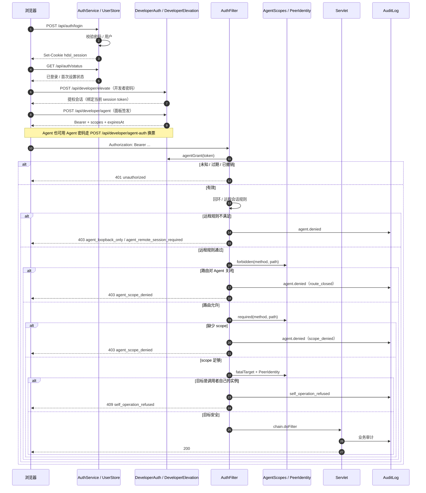

# 认证、开发者提权与 Agent 票据

这张图覆盖两条进入面板的路：浏览器会话 Cookie，和 AI Agent 的 Bearer 票据。两条路最后都落到 `AuthFilter`，再经过 scope 检查和自杀闸；敏感路由还会再过 `DeveloperGuardFilter`。

## 关键点

- **公开路由**：`/api/auth/login`、`/api/auth/status`、`/api/auth/setup`、`/api/health`、`/api/developer/agent-auth` 不需要会话；其余 `/api/*`、`/i/*`、`/ws/*` 默认要过门。
- **两种凭据不互相提权**：Bearer 票据有自己的一套 scope，不会因为同时带了 Cookie 就扩大；Cookie 只作为远程 Agent 的第二个因子。
- **scope**：`read`、`mc`、`mc-console`、`system`、`instances`、`config`、`plugins`。`GET`/`HEAD` 默认落到 `read`，`/api/system/*` 单独要 `system`。
- **默认拒绝**：`AgentScopes.required` 没覆盖的路由返回 `null`，`AuthFilter` 直接按拒绝处理；新路由不会自动对 Agent 开放。
- **自杀闸**：`PeerIdentity` 从内核连接信息推导调用者所在实例；无法定位时按保守策略处理。停、删、接管自己所在实例会返回 `409 self_operation_refused`。
- **开发者提权**：`DeveloperGuardFilter` 加在 `AuthFilter` 之后，负责终端、E-Stop、敏感设置等路由的二次确认；未登录仍应先得到 401，而不是 guard 的拒绝。
- **审计**：放行和拒绝都写 `audit.jsonl`；Agent 请求记录 `agent:<label>`、scopes、grant id，不记录票据本身。
