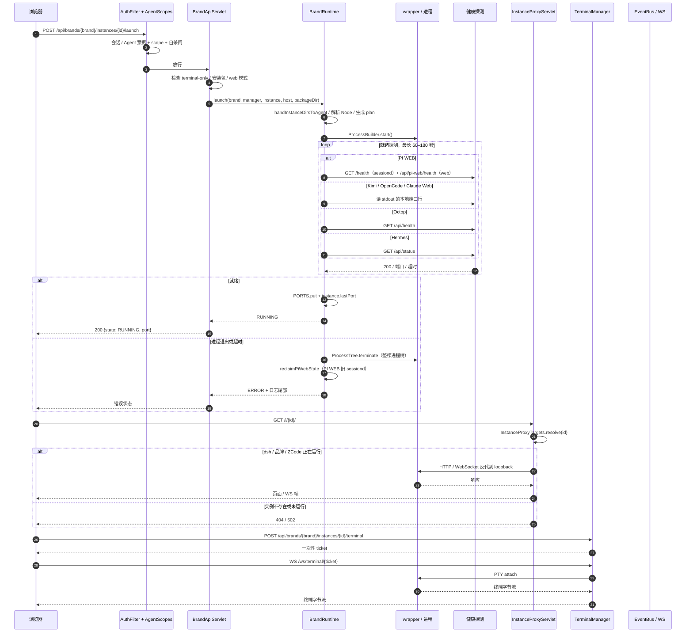

# 品牌实例启动、反代与终端

这张图覆盖 `BrandApiServlet` 的启动路径，以及启动成功后的 `/i/{id}/` 反代和 `/ws/terminal/{ticket}` 终端。PI WEB 的双进程、Hermes 的 gateway、Octop 的慢启动都在 `BrandRuntime` 里分支处理。

## 关键点

- **PI WEB 是双进程**：wrapper 先起 `sessiond`，等 `/health` 再起 web；面板的健康探测必须走 **HTTP/1.1**，否则 Fastify 会对 JDK 默认的 `Upgrade: h2c` 回 400，实例会被误判为没起来。
- **失败清理**：就绪失败不会只杀 wrapper，而是 `ProcessTree.terminate` 收掉整棵树；PI WEB 还会在下次启动前清理 `sessiond-owner.json` 指向的旧 daemon，避免 `SessiondStateOwnershipConflictError`。
- **反代目标**：`/i/{id}/` 只服务 dsh、品牌和 ZCode；Minecraft 没有 `/i/` 页面，控制台走 `/ws/terminal/{ticket}`。
- **终端**：浏览器先拿一次性 ticket，再升级 WebSocket；PTY 在面板进程内，浏览器只是查看器。
- **自杀闸**：Agent 票据如果目标是调用者自己所在的实例，`PeerIdentity` 会拒绝并返回 `409 self_operation_refused`，避免把发请求的进程杀掉。
- **Hermes 互斥**：终端和网页共用同一个 gateway 时，`BrandApiServlet` 会先关闭终端 / 释放 detached gateway，再启动网页模式。
