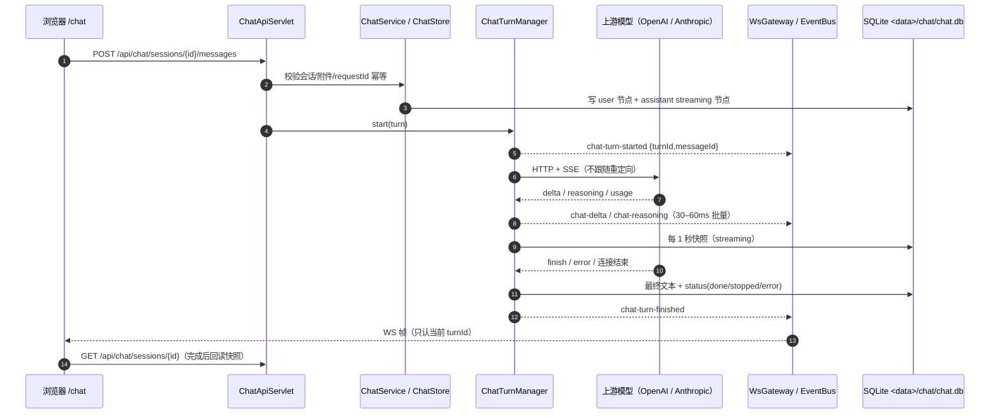
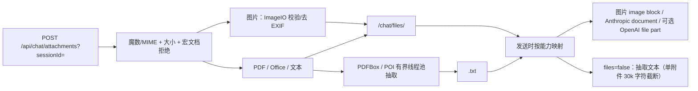
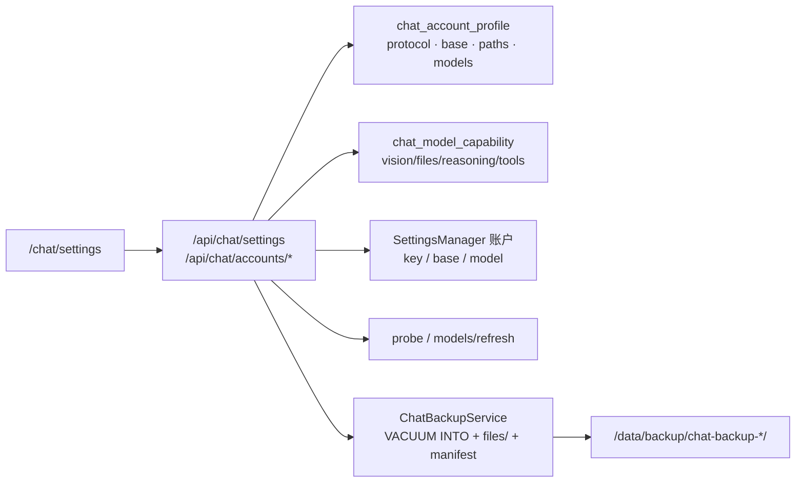

# 面板聊天：命令、流、附件与设置

本图固定聊天 v1 的边界：**命令走 REST，token 流走既有 `/ws`，存储只在 `<data>/chat/`**。它不展开到每个类，类级细节看 [`docs/chat.md`](../../chat.md) 与 `web/chat` 包。

## 一次 turn

- 停止：`POST /api/chat/turns/{turnId}/cancel` 关闭上游流，落 `stopped` + 部分内容。
- 重生成：`in_place` 给助手节点加 variant；`truncate_after` 删除目标之后的节点再生成。
- 编辑：更新用户消息 + 删除后续节点 + 重新生成。
- 幂等：客户端带 `requestId`，服务端 10 分钟内重复请求返回同一 turn。

## 附件

- 附件按 sha256 去重；删除会话/节点时清记录，孤儿文件由 `pruneOrphans` 清。
- Office 的 docx/pptx/xlsx 没有可移植原生块，统一走抽取文本；音频/视频只保存。

## 设置与模型服务

- 账户 key 仍只在 Java 后端使用；聊天页不返回明文 key。
- `/api/chat/*` 对 agent ticket 全关；设置/备份/端点/能力覆盖要求开发者提权。
- 聊天设置只写 `chat_account_profile` / `chat_model_capability` / `chat_setting`，不改主界面账户页。
