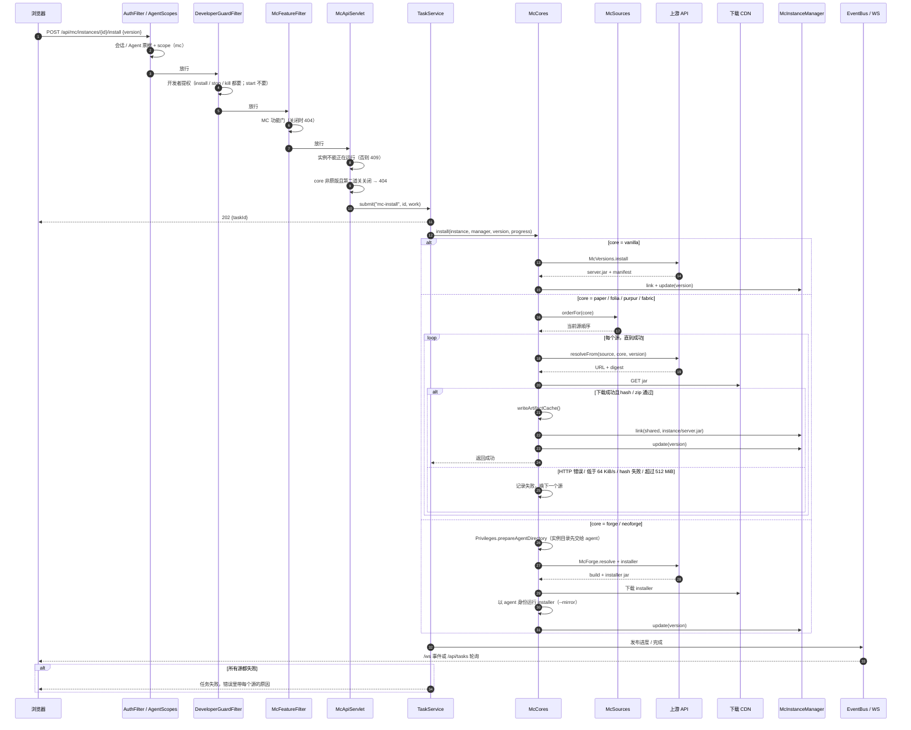

# MC 安装与下载源回退

这张图对应 `McApiServlet` → `TaskService` → `McCores.install` 的主路径，重点是**三道门、源顺序、慢源判定、失败换源**。Forge/NeoForge 走 `McForge` 的 installer 分支，图里单独标出。

## 关键点

- **三道门叠在一起，顺序不能换**：`AuthFilter`（会话 / Agent 票据 + scope）→ `DeveloperGuardFilter`（开发者提权）→ `McFeatureFilter`（功能关闭时 `/api/mc/*` 一律 404）。创建实例、安装、停止、删除要提权；`start` 不要提权，但仍受功能门约束。
- **第二道关**：`core != vanilla` 的创建与启动都检查 `thirdPartyEnabled()`，关闭时同样回 404（不发 403，不泄露“这里原本有第三方”）；关闸时 `GET /cores` 也不返回第三方核心。
- **下载窗口**：`McCores.download` 每读一块就按当前 10 秒窗口算一次吞吐，窗口内不足 `640 KiB`（约 64 KiB/s）即判定该源不可用并换源；单个 jar 绝对上限 512 MiB，单次 HTTP 请求超时 10 分钟。慢源不会再把任务挂到 30 分钟超时。
- **换源**：`downloadFromAnySource` 按 `McSources.orderFor(core)` 逐个尝试。解析失败、HTTP 非 200、hash 不匹配、zip 校验失败、下载过慢、体积超限都会进入下一个源；只有全部失败才把每个源的原因拼进错误。
- **取消**：下载循环每块都检查线程中断标志，`TaskService.cancel` 能立刻让任务退出，不会留下继续增长的 `.part`。
- **缓存**：`artifact.json` 只在下载并校验成功后写入；失败源不会污染下一次安装。已经可复用的共享 jar 会直接 `link`，不再下载。
- **进度**：`McCores` 通过 `McVersions.Progress` 更新“下载 x / y MB”，`TaskService` 再经 `EventBus` 送到 `/ws` 或 `/api/tasks`；phase 文案由核心自己给，installer 下载阶段不会再显示成 “Installing”。
- **Forge/NeoForge**：不是直接下 ready jar，而是先解析 build、下载 installer，再用 `--mirror`（必须带结尾斜杠）跑安装器。installer 以 **agent 身份**运行，实例目录在运行前已交给 agent；库文件由 installer 自己下。
- **Fabric 首次启动**：面板只下 179 KB 左右的 Fabric server launcher；Minecraft 服务端、Fabric 库和 remap 是 launcher 在首次启动时自己下的。这条路径不受面板“下载源”设置控制，详见 [docs/minecraft.md](../../minecraft.md)。
