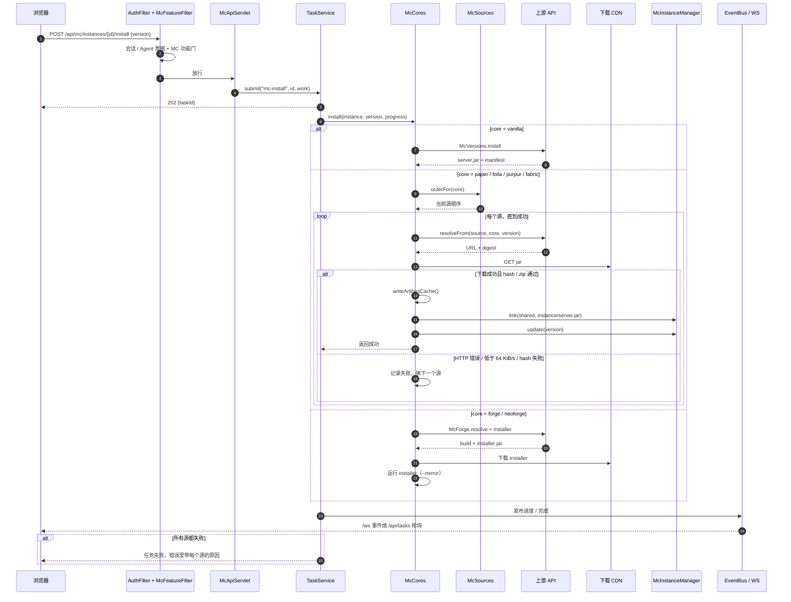

# MC 安装与下载源回退

这张图对应 `McApiServlet` → `TaskService` → `McCores.install` 的主路径，重点是**源顺序、慢源判定、失败换源**。Forge/NeoForge 走 `McForge` 的 installer 分支，图里单独标出。

## 关键点

- **下载窗口**：`McCores.download` 每 10 秒看一次吞吐，低于 `640 KiB`（约 64 KiB/s）就判定该源不可用；单个 jar 的绝对上限是 10 分钟。慢源不会再把任务挂到 30 分钟超时。
- **换源**：`downloadFromAnySource` 按 `McSources.orderFor(core)` 逐个尝试。解析失败、HTTP 非 200、hash 不匹配、zip 校验失败、下载过慢都会进入下一个源。
- **缓存**：`artifact.json` 只在下载并校验成功后写入；失败源不会污染下一次安装。已经可复用的共享 jar 会直接 `link`，不再下载。
- **进度**：`McCores` 通过 `McVersions.Progress` 更新“下载 x / y MB”，`TaskService` 再经 `EventBus` 送到 `/ws` 或 `/api/tasks`。
- **Forge/NeoForge**：不是直接下 ready jar，而是先解析 build、下载 installer，再用 `--mirror` 跑安装器；库文件由 installer 自己下。
- **Fabric 首次启动**：面板只下 179 KB 左右的 Fabric server launcher；Minecraft 服务端、Fabric 库和 remap 是 launcher 在首次启动时自己下的。这条路径不受面板“下载源”设置控制，详见 [docs/minecraft.md](../../minecraft.md)。
