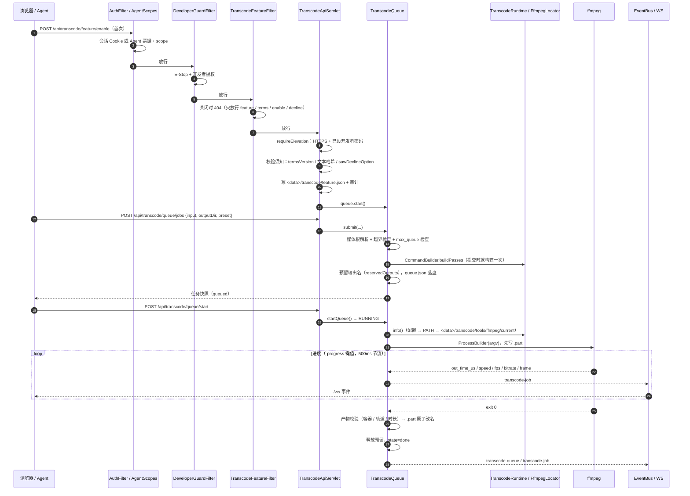
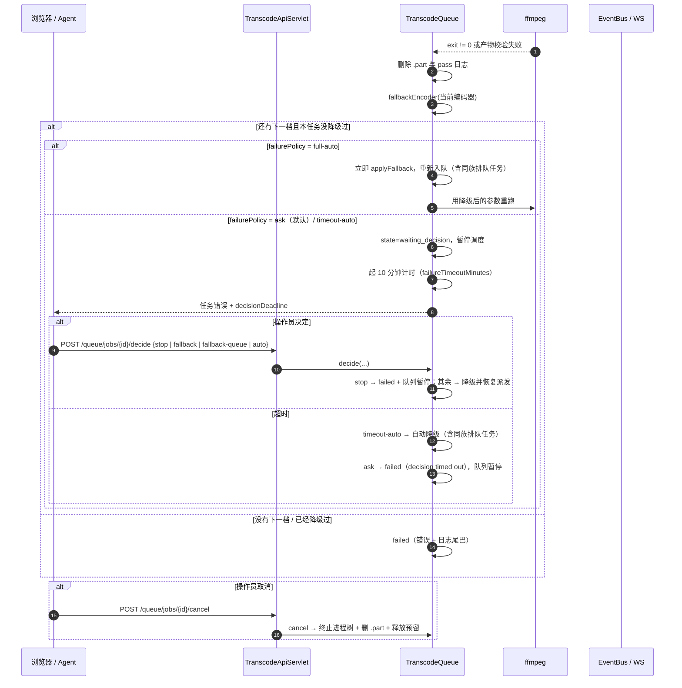
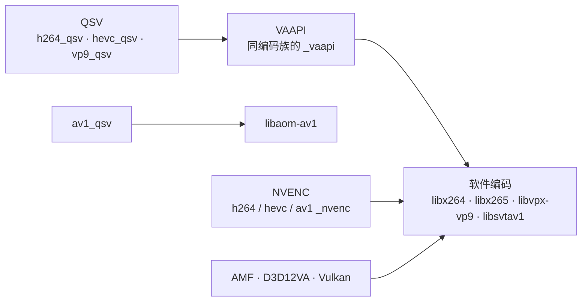

# 转码：功能门、队列与失败降级

这张图对应 `TranscodeApiServlet` → `TranscodeQueue` → `ffmpeg` 的主路径，重点是**三道门、服务端队列、硬件失败的决策与降级链**。预设/命令生成、工具与质量评测只画到与队列共用的那部分，字段级细节看 [docs/transcode.md](../../transcode.md)。

## 启用与提交

## 硬件失败：决策与降级

降级链是 QSV → VAAPI → 软件编码；但**每个任务只自动走一格**——`fallbackAttempted` 置位后不再自动降级，避免硬件坏了无限重试。要继续往下掉，由操作员 retry（重试会清零这个标记），或直接在参数面板换编码器。

## 关键点

- **三道门的顺序不能换**：`AuthFilter`（会话 / Agent 票据 + scope）→ `DeveloperGuardFilter`（E-Stop、启用的提权）→ `TranscodeFeatureFilter`（关闭时 404）。启用要 HTTPS + 已设开发者密码；`feature/*`、`settings/*`、`runtime/*` 对 Agent 票据一律禁止，队列 / 预设 / 工具要 `transcode` scope，媒体浏览（能枚举磁盘）与自定义命令的原始 argv 要 `transcode-raw`。
- **功能关闭 = 不存在**：状态在 `<data>/transcode/feature.json`，不写 `server.yaml`；关闭时除启用流程外 `/api/transcode/*` 一律 **404**（不是 403），同时 `queue.stop()` 终止子进程、把未完成任务标 `cancelled`。
- **队列在服务端**：`runState` 只有 `IDLE / RUNNING / PAUSED`；`max_concurrent`（默认 1）控制同时编码数，`max_queue`（默认 20）在提交时拒绝。浏览器关掉、Agent 断开都不影响已入队的任务。
- **重启语义**：运行中的任务在重启后标 `failed: interrupted`（不会留下孤儿 ffmpeg），排队任务保留；`autoResume` 只决定重启后是否继续派发，不是断点续跑。
- **输出不互相覆盖**：提交时就预留输出名，同一个输入同预设连续提交会得到不同文件名；完成时 `.part` 原子改名，失败/取消删 `.part` 并释放预留，retry 重新预留。
- **失败分三档**（`transcode.failure_policy`）：`ask`（默认，等人决定）、`timeout-auto`（10 分钟没人管就自动降级，`failureTimeoutMinutes` 可调）、`full-auto`（立即降级）。降级动作可以只影响当前任务，也可以顺带把同编码器族的**排队**任务一起改；`stop` 会把队列停在 `PAUSED`，让人先看日志。
- **硬件失败先实测再报错**：能力探测走 `capabilities/probe`，用 1 帧真实编码试 QSV/VAAPI/NVENC，而不是只看 `-encoders` 列表；QSV 带 `-low_power 1`，VAAPI 注入设备参数。拿不到编码器就直接标不可用，不静默换成软件编码。
- **队列也跑工具**：合并 / 混流 / 抽流通过 `submitCommand` 入同一个队列，拿到同样的日志、进度、取消与 `.part` 改名；质量评测（PSNR / SSIM / XPSNR / VMAF，VMAF 需要 `libvmaf`）在 `tools/quality` 下单独起 job，逐帧曲线由前端画。
- **ffmpeg 由面板自己装**：`FfmpegInstaller` 支持静态包（校验 SHA-256，可读 `.sha256` / `SHA256SUMS` 侧车）、apt / dnf / zypper、源码 `configure && make`，产物落在 `<data>/transcode/tools/ffmpeg/current`；装完 `runtime.refresh()` 重新探测，不需要重启面板。
- **媒体根不在 `/data`**：`HDSL_MEDIA_ROOT` / `transcode.media_root`，裸部署回退 `<data>/video`；容器镜像指向 `/home/hdsl/video`（宿主影音库的挂载点）。所有输入输出路径都经 `MediaBrowser` 归一化并拒绝越界。
