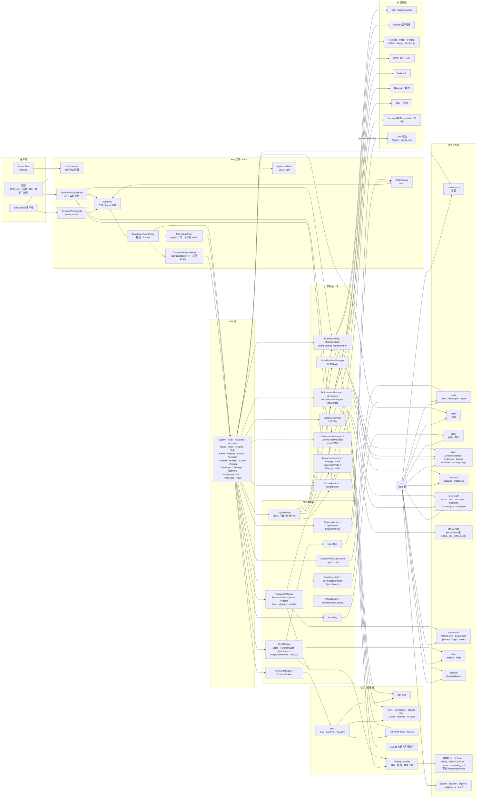
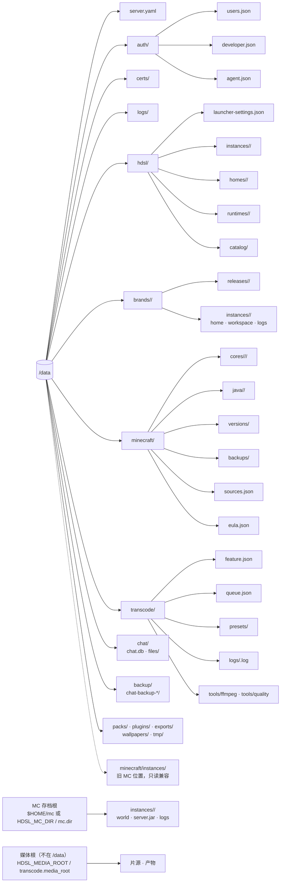

# 全量模块与数据布局（战术）

这张图是**模块级全量**：把边缘、API、控制面服务、实例运行时、进程/PTY、`/data` 和外部依赖放在一张图上。它不展开到类和方法；单个品牌或单个下载器的细节看 `flows/`。

> 图较大，建议在 GitHub 里点开全屏查看。节点 ID 是给 Mermaid 用的，标签才是给人看的。

## API 面

| 前缀 | Servlet | 职责 |
|---|---|---|
| `/api/system/*` | `SystemApiServlet` | CPU / 内存 / 磁盘 / 网络 / GPU 快照 |
| `/api/auth/*`、`/api/health` | `ApiServlet` + `AuthFilter` | 登录、首次设置、健康检查 |
| `/api/instances/*` | `InstancesApiServlet` | dsh 实例的创建、启停、终端、导入导出 |
| `/api/versions` | `VersionsApiServlet` | 游戏版本清单 |
| `/api/tasks/*` | `TasksApiServlet` | 任务列表、取消、进度 |
| `/api/node/*` | `NodeApiServlet` | 托管 Node 运行时与消费者视图 |
| `/api/plugins/*`、`/api/dsh/*` | `PluginsApiServlet`、`DshApiServlet` | 第一方 TUI 插件与 dsh 目录 |
| `/api/packs/*`、`/api/exports/*` | `PacksApiServlet`、`ExportsApiServlet` | 整合包与实例导出 |
| `/api/doctor`、`/api/accounts/*`、`/api/vendors`、`/api/models/*` | 对应 Servlet | 自检、账户、供应商、模型目录 |
| `/api/zcode/*` | `ZcodeApiServlet` | ZCode 实验性构建与运行 |
| `/api/brands/*` | `BrandApiServlet` | 品牌安装、实例、日志、终端、反代入口 |
| `/api/developer/*` | `DeveloperApiServlet` | 开发者提权、Agent 票据、E-Stop |
| `/api/settings/*` | `TlsApiServlet`、registry / 日志保留 / 品牌源 | TLS、registry、品牌源、日志保留 |
| `/api/network/*` | `NetworkApiServlet` | 代理、超时、网络自检 |
| `/api/wallpapers/*` | `WallpaperApiServlet` | 壁纸 |
| `/api/mc/*` | `McApiServlet` | MC 实例、核心、Java、插件、世界、备份、控制台（受 `McFeatureFilter` 保护） |
| `/api/transcode/*` | `TranscodeApiServlet` | 功能门、媒体浏览、预设/参数集、队列与任务、工具、质量评测、ffmpeg 安装（受 `TranscodeFeatureFilter` 保护） |
| `/api/chat/*` | `ChatApiServlet` | 会话/助手、发送/编辑/重生成/停止、附件、模型服务/能力/probe、设置与备份；对 agent 票全关 |
| `/i/{id}/*` | `InstanceProxyServlet` | dsh / 品牌 / ZCode 的 HTTP + WebSocket 反代 |
| `/ws/*`、`/ws/terminal/*` | `WsGateway`、`TerminalWebSocket` | 事件流、终端 PTY |
| `/` | `StaticServlet` | React SPA |

## 端口与进程

| 端口 / 通道 | 归属 | 说明 |
|---|---|---|
| `:3080` | 面板 | HTTP 入口（`https.enabled` 打开后变 HTTPS）；可被 nginx/Caddy 再包一层 |
| `3081–4081` | dsh | `DshPorts` 的实例端口池 |
| `20000–60999` | 品牌实例 | `BrandRuntime` 预分配的 loopback 端口 |
| `25565` / `25575` | MC | 对玩家开放的游戏端口 / RCON，每个实例可单独配置 |
| `/i/{id}/` | 反代 | 只代理 dsh、品牌、ZCode；MC 不走这里 |
| `/ws/terminal/{ticket}` | 终端 | 一次性 ticket 换取 PTY 连接 |
| — | 转码 | 不监听端口：队列在面板 JVM 内，由它拉起 `ffmpeg` / `ffprobe` 子进程 |
| — | 聊天 | 不监听端口：REST + 既有 `/ws`；SQLite 在 `<data>/chat/`，备份在 `/data/backup/` |

## 数据布局

## 读图提示

- `api` 是一个聚合节点，具体路由看上面的表；Servlet 之间不互相调用，业务都在 `services` / `runtime`。
- `task` 是长任务的入口：MC 安装、Java 安装、整合包、品牌安装都可能在这里跑；`EventBus` 把进度送到 `/ws`。
- `proxy` 不直接持有实例，它通过 `InstanceProxyTargets` 向 `BrandRuntime` / `ZcodeRuntime` / dsh 进程池要 loopback 端口。
- `ptyp` 是终端复用的那一层：品牌 TUI、dsh TUI、MC 控制台都最终落到 PTY。
- `mcfilter` 是 MC 的第一道门：功能关闭时 `/api/mc/*` 返回 **404**（不是 403），让“这里原本有东西”不可见。第二道门（第三方核心）在 `McApiServlet` 内部按同样口径 404，不出现在这条 Filter 链上。
- `tcfilter` 是转码的同一道口径：关闭时除 `feature` / `terms` / `enable` / `decline` 外一律 404。启用要 HTTPS + 开发者密码 + 须知，状态落在 `<data>/transcode/feature.json`，不写 `server.yaml`。
- `tx` 是自成一体的模块：队列、预设、工具、质量评测、ffmpeg 安装都挂在同一个 `TranscodeModule` 下，**不依赖** `dsh` / `brand` / `minecraft` 的运行时；`txrt` 负责定位与探测 ffmpeg，队列派发 `ffmpegp`。
- `ffmpegp` 是面板拉起的外部进程，不是受管实例：读写 `media`，日志写 `<data>/transcode/logs/`，输出先落 `.part` 再原子改名；硬件失败走 `flows/transcode.md` 里的决策与降级链。
- `chat` 是面板自己的功能，不绑定实例：SQLite 在 `<data>/chat/`，附件按 sha256 去重；token 流走既有 `/ws` 的 `chat:<sessionId>`，命令走 REST。它只依赖账户记录里的 key/base/model，不改主界面账户页；设置/备份/probe 要求开发者提权。见 `flows/chat.md`。
- `sysm` 的 GPU 数据来自 `/sys/class/drm` 与 `nvidia-smi`，读不到就返回空列表——图上的 `gpu` 是宿主驱动，不是网络依赖。
- `/ws/terminal/{ticket}` 在 `AuthFilter` 里是一条公开路径，但它自己就是门：握手时校验一次性 ticket **且** 校验签发票据的会话 Cookie 或 Agent 授权（见 `flows/auth.md`）。
- `/data` 是面板的持久化边界（含 `transcode/`）；媒体根与 MC 存档根都可能不在 `/data` 下——前者看 `HDSL_MEDIA_ROOT` / `transcode.media_root`，后者看 `mc.dir` / `HDSL_MC_DIR`（后者优先）/ `$HOME/mc`。
